  
  
  

## 🔥 Quem somos

Somos dois amigos que fundaram um estúdio para criar jogos no Roblox com cara própria. Cada jogo tem o seu gênero, do terror à festa, e todos ficam melhores quando você joga com os amigos. Ao longo do ano, temporadas trazem temas novos para os jogos.

## 🎮 Nossos jogos

  

| | |
| --- | --- |
| **Gênero** | Terror cooperativo |
| **Status** | Em desenvolvimento, em breve no Roblox |
| **Plataforma** | Roblox |
| **Jogadores** | Sozinho ou com amigos |

- **O Medo te ouve:** andar, correr e atirar fazem barulho.
- **Lanterna e pilhas:** a luz é sua única aliada, e ela acaba.
- **5 chaves** para abrir a saída.
- **Reanime o amigo caído** antes que seja tarde.

## 🛠️ Como criamos

- Roblox Studio e Luau.
- Código versionado no GitHub.
- Playtests com a galera.

## 👥 Time

<table align="center">
  <tr>
    <td align="center" width="200">
      
       
      <a href="https://github.com/MatheusRibeir098"><b>MatheusRibeir098</b></a>
       
      Cofundador
    </td>
    <td align="center" width="200">
      
       
      <a href="https://github.com/L3ozin"><b>L3ozin</b></a>
       
      Cofundador
    </td>
  </tr>
</table>

